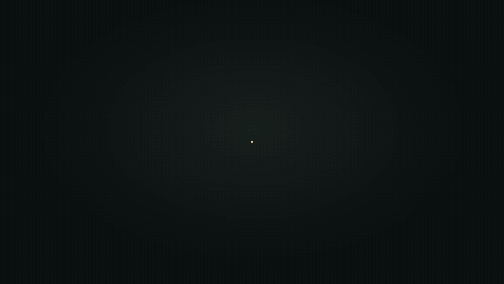
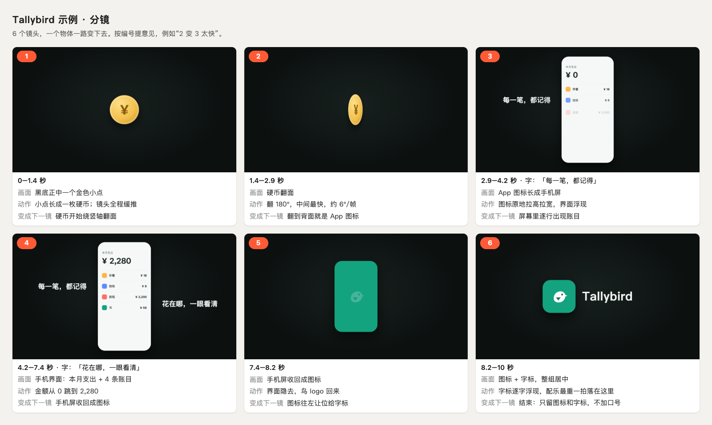

<div align="center">

# motion-skill

**A Claude Skill that makes 4K motion graphics videos with code — no AI video generation.**

Product launch videos, app promos, logo animations, 3D product shots, explainer animations, silhouette transitions into live footage. Tell Claude "make a 10-second launch video for my app". It drafts a numbered storyboard, waits for your OK, builds the animation as an HTML page (or a Blender scene), renders it frame by frame to 3840×2160, checks every transition, then adds music and sound effects on the beat.

[](https://github.com/risingjerry/motion-skill/actions/workflows/ci.yml)
[](LICENSE)
[](https://github.com/risingjerry/motion-skill/releases)
[](https://github.com/risingjerry/motion-skill/stargazers)

English · [简体中文](README.zh-CN.md)



</div>

The 10-second promo above (for "Tallybird", a made-up budgeting app) was built from scratch by the example script in this repo: `python3 examples/minimal/build.py` renders it to 4K with sound in about a minute on an 8-core laptop. Every pixel comes from code and your own assets — no image or video model is involved.

## Install

Needs Node.js 18+, Python 3.9+, ffmpeg and Google Chrome (or Chromium). Blender is optional.

```bash
git clone https://github.com/risingjerry/motion-skill.git ~/.claude/skills/motion
cd ~/.claude/skills/motion
npm install
python3 -m venv .venv && .venv/bin/pip install -r requirements.txt
.venv/bin/python scripts/doctor.py
```

Every line of the doctor report should start with `OK`, and the last line says all required pieces are present. If something is missing, it prints how to install it. On Windows use `%USERPROFILE%\.claude\skills\motion` and `.venv\Scripts\` instead of `.venv/bin/`.

<details>
<summary>Install with <code>npx skills</code> instead</summary>

```bash
npx skills add risingjerry/motion-skill -g -a claude-code
cd ~/.claude/skills/motion
npm install
python3 -m venv .venv && .venv/bin/pip install -r requirements.txt
```

`-a claude-code` puts the skill in `~/.claude/skills/motion`. Without `-a`, the CLI asks which agents to install for. The skill runs its own scripts, so the `npm install` / `pip install` step is still needed in the installed folder.

</details>

## Run the example first

```bash
.venv/bin/python examples/minimal/build.py
```

It writes to `examples/minimal/out/`:

| File | What it is |
|---|---|
| `storyboard.png` | Numbered storyboard (on a real job, Claude stops here until you approve) |
| `ad.mp4` | 3840×2160, 30 fps silent cut |
| `frames.jpg` + `frames/` | 3 frames pulled from the 4K cut (full-size PNGs) |
| `ad-sound.mp4` | The cut with music and sound effects (video stream copied, not re-encoded) |
| `mix.wav` | The mix, -14 LUFS, true peak ≤ -1 dBTP |

The terminal prints the layout check (`LAYOUT_CHECK GREEN`) and a mix report (where the music's biggest hit lands and the loudness). Add `--scale 1` for a quick 1080p run.



## Use with Claude Code, Codex and other agents

Once it is in `~/.claude/skills/motion`, Claude Code finds the skill by itself. Just ask:

- "Use the motion skill to make a 12-second launch video for my budgeting app. The logo is `assets/logo.svg`, screenshots are in `assets/screens/`."
- "I have a GLB model of my earbuds case. Make a Blender single-light studio shot of it opening — show me the storyboard first."
- "Animate our logo for a 5-second intro, and make a 20-second explainer of how sync works using our real screenshots."
- "Slow down the morph from shot 3 to shot 4, and land the music's biggest hit on the icon."

Codex, Cursor and other agents read [`AGENTS.md`](AGENTS.md) at the repo root. The skill instructions ([`SKILL.md`](SKILL.md), [`references/`](references/)) are written in Chinese; Claude and other modern agents follow them fine in any language you talk to them in.

## What it does

1. **Asks, then collects real assets** — the real logo, real screenshots (personal info removed), brand colors. For a physical product, real photos first.
2. **Numbered storyboard, then waits for you** — `render.mjs board` draws one storyboard image. No final render without your OK.
3. **Builds the page** — starts from `templates/2d.html` (flat) or `templates/3d.html` (CSS 3D); every beat lives in one place.
4. **Checks frame by frame** — pulls 3–4 frames from every transition into a contact sheet; scripts measure whether text overlaps the subject and whether the subject stays centered; for 3D, mesh collisions, rotation speed and lid seams.
5. **Renders 4K only** — `render.mjs video --scale 2`.
6. **Adds sound last** — the music's biggest hit lands on the key moment, effects sit on the beats, music ducks under effects, loudness hits -14 LUFS.

The craft rules (every shot morphs out of the previous one, action stays at the center, the frame never freezes, one light for 3D, end on the icon and wordmark only…) are in [`SKILL.md`](SKILL.md) and [`references/`](references/).

## Three levels

| Level | On screen | Tools |
|---|---|---|
| 1. Flat motion | Real logo, screenshots and shapes morphing into each other | `templates/2d.html`, `scripts/render.mjs` |
| 2. Browser 3D + live footage | UI cards in 3D space with a moving camera; silhouette transitions into real footage | `templates/3d.html`, `scripts/silhouette.py` |
| 3. Blender studio | Physical product model, one light, real materials | `scripts/blender/studio.py`, `motion_check.py`, `seam_check.py` |

## Scripts

| Script | Purpose |
|---|---|
| `scripts/render.mjs` | HTML → stills / 4K mp4 / element position probe / storyboard board |
| `scripts/sheet.py` | Pull frames by time from the full-resolution cut into a contact sheet |
| `scripts/layout_check.py` | Text ≥ 40 px from the subject (at 4K), subject centered |
| `scripts/seam_check.py` | Seam offset between two parts at the real camera angle ≤ 1 px |
| `scripts/blender/studio.py` | Single-light studio + EEVEE/Cycles render; reads GLB/glTF/USDZ/OBJ/FBX/STL/PLY; `--demo` ships a sample model |
| `scripts/blender/motion_check.py` | Per-frame mesh collisions (BVH), angular speed ≤ 6°/frame, no speed jumps |
| `scripts/silhouette.py` | Person mask (macOS Vision, optional) → smooth vector silhouette, pulling out from a close-up |
| `scripts/audio/synth.py` | Code-synthesized sound-effect pack and music bed (royalty-free) |
| `scripts/audio/mix.py` | Align music to the hit, place effects on beats, sidechain ducking, loudness normalization, mux into the video |
| `scripts/encode.py` | PNG frames → mp4 |
| `scripts/doctor.py` | Dependency check (`--json` for agents) |

Check scripts print `... GREEN` or `... RED` on their last line and exit 0 (green), 1 (red) or 2 (usage error).

## Limits

- **Speed**: a 10-second HTML piece renders to 4K in about 1–3 minutes; Blender EEVEE at 4K takes a few to a dozen seconds per frame, so a 15-second 3D shot can take an hour. Run one 4K job at a time, or the machine may stall.
- **Automatic person masks need macOS 14+** (the built-in Vision framework). Elsewhere, export a black-and-white mask with rembg, MediaPipe or your editor; the silhouette script works the same.
- **Blender is optional**: levels 1 and 2 work without it.
- **Nobody "listened" to the mix**: scripts align timing and measure loudness, but whether it sounds good needs a human with headphones.
- **No brand assets, 3D models, sound libraries or music are included.** The example uses a hand-made SVG and code-synthesized sound. You need the rights to your own assets.
- Tested by the author on macOS; CI runs the tests and the example on Ubuntu.

## FAQ

### How do I make a product video or motion graphics without AI video generation?
Write the animation as code. Here each frame is an HTML page (or Blender scene) computed from time `t`; a headless browser captures every frame and ffmpeg encodes them to 4K. Changing "a bit slower here" means changing one number and re-rendering.

### Can Claude Code make videos?
Yes, with this skill. Claude writes the animation page, renders it with the bundled scripts, checks the frames itself and mixes the sound. You provide real assets and approve the storyboard.

### Do I need to know how to code or use Blender?
No. Claude writes the code and runs Blender in the background; you never open it. Your job is to supply real assets, look at the storyboard and give feedback.

### How long can the videos be?
It is designed for short pieces — launch videos, promos, logo intros, product shots, explainer segments; the rules were tuned on 8–20 second videos. Longer renders work, but the workflow (every shot morphs out of the previous one) suits short pieces.

### Why a storyboard first?
At the storyboard stage, changing a sentence changes a shot; after rendering, the same change means starting over. Numbered shots let you say exactly "3 to 4 is too fast".

### How does the music's climax land on the key moment?
`mix.py` finds the strongest hit in the music (or takes the second you give it) and shifts the whole track so that hit lands on the beat you name. It only shifts — no time-stretching, no pitch change.

### Can I use another brand's logo?
Only for brands you own or are allowed to use. Practice pieces must not pose as official work or be run as ads.

### Does it work on Windows or Linux?
The HTML rendering, check scripts, sound scripts and Blender parts are written to be cross-platform, and CI runs them on Linux. The author has only tested on macOS. Automatic person masks are macOS-only.

## Data and privacy

Everything runs on your machine. Nothing goes online (except `npm install` / `pip install` fetching dependencies), no file is uploaded, and no account or key is needed. Rendering uses a local headless browser with a fresh, empty profile, so it never reads your everyday browser data.

## Uninstall

```bash
rm -rf ~/.claude/skills/motion
```

## Support, contributing and security

Questions, bug reports and ideas are welcome in [Issues](https://github.com/risingjerry/motion-skill/issues) — include the output of `python3 scripts/doctor.py --json` and the failing command. See [CONTRIBUTING.md](CONTRIBUTING.md). Report vulnerabilities privately as described in [SECURITY.md](SECURITY.md).

## Credits

The idea was inspired by a video from Rourke (GenHQ): https://www.youtube.com/watch?v=cDb-wPq0Iyk. This project is not affiliated with Rourke or GenHQ; all text and code here were written independently.

## License

[MIT](LICENSE). The Tallybird name and logo in the example are made up and ship under MIT with the repo; the sounds `synth.py` generates are free for commercial use too.

---

If it helped you ship a video, a ⭐ helps others find it.

[](https://star-history.com/#risingjerry/motion-skill&Date)
