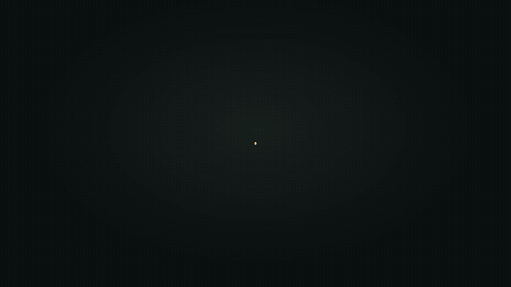
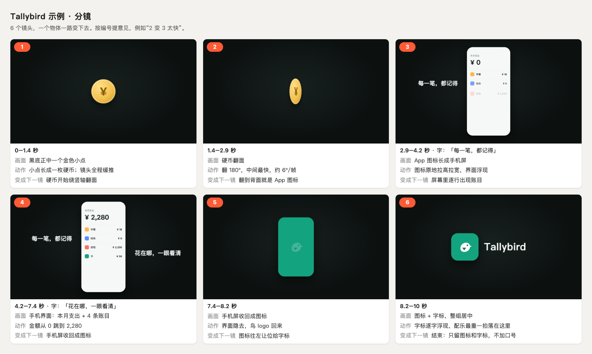

<div align="center">

# motion-skill

**一个让 Claude 用代码做 4K 动效短片的 Skill，全程不用 AI 生视频。**

产品发布片、App 宣传片、logo 动画、实物产品 3D 镜头、讲解动效、接真人实拍的剪影转场都能做。对 Claude 说“给我的 App 做一条 10 秒的发布视频”，它会先出带编号的分镜给你看，你点头后用 HTML（或 Blender）一帧一帧渲出 3840×2160 的成片，逐帧检查每个转场，最后按节拍配上配乐和音效。

[](https://github.com/risingjerry/motion-skill/actions/workflows/ci.yml)
[](LICENSE)
[](https://github.com/risingjerry/motion-skill/releases)
[](https://github.com/risingjerry/motion-skill/stargazers)

[English](README.md) · 简体中文



</div>

上面这条 10 秒示例（虚构的记账 App “Tallybird”的宣传片）就是用仓库自带的脚本从零做出来的：`python3 examples/minimal/build.py`，在一台 8 核笔记本上约 1 分钟出 4K 有声成片。画面全是代码和你的真素材，没有用任何生图、生视频模型。

## 安装

需要：Node.js 20+、Python 3.9+、ffmpeg、Google Chrome（或 Chromium）。Blender 可选。

```bash
git clone https://github.com/risingjerry/motion-skill.git ~/.claude/skills/motion
cd ~/.claude/skills/motion
npm install
python3 -m venv .venv && .venv/bin/pip install -r requirements.txt
.venv/bin/python scripts/doctor.py
```

应该看到每一项前面是 `OK`，最后一行是“必需的都齐了，可以开始。”；缺什么它会写出怎么装。
Windows 用 `%USERPROFILE%\.claude\skills\motion`，把 `.venv/bin/` 换成 `.venv\Scripts\`。

<details>
<summary>也可以用 <code>npx skills</code> 安装</summary>

```bash
npx skills add risingjerry/motion-skill -g -a claude-code
cd ~/.claude/skills/motion
npm install
python3 -m venv .venv && .venv/bin/pip install -r requirements.txt
```

`-a claude-code` 会装到 `~/.claude/skills/motion`；不加 `-a` 时它会问你装给哪些 Agent。这个 Skill 要跑自带的脚本，所以装好后仍要在安装目录里执行 `npm install` 和 `pip install`。

</details>

## 先跑一遍示例

```bash
.venv/bin/python examples/minimal/build.py
```

会在 `examples/minimal/out/` 里生成：

| 文件 | 是什么 |
|---|---|
| `storyboard.png` | 带编号的分镜板（真正做片时，这一步要等对方点头） |
| `ad.mp4` | 3840×2160、30 fps 的无声成片 |
| `frames.jpg` + `frames/` | 从 4K 成片里抽的 3 帧（原尺寸 PNG） |
| `ad-sound.mp4` | 加了配乐和音效的成片（视频流原样拷贝，没有重新编码） |
| `mix.wav` | 混音，-14 LUFS、真峰值 ≤ -1 dBTP |

终端里会打印布局检查（`LAYOUT_CHECK GREEN`）和混音报告（配乐最重的一拍落在第几秒、响度多少）。加 `--scale 1` 可以用 1080p 快速试跑。



## 在 Claude Code、Codex 等 Agent 里用

装到 `~/.claude/skills/motion` 后，Claude Code 会自动发现这个 Skill。直接说：

- “用 motion 给我的记账 App 做一条 12 秒的发布视频，logo 在 `assets/logo.svg`，截图在 `assets/screens/`。”
- “我有耳机充电盒的 glb 模型，做一条 Blender 单灯棚拍的开盖镜头，先给我分镜。”
- “给我们的 logo 做一段 5 秒的开场动画，再用真截图做一段 20 秒的同步功能讲解动效。”

Codex、Cursor 等其他 Agent 读仓库根目录的 [`AGENTS.md`](AGENTS.md)。

## 它会怎么做

1. **问清楚、备真料**：真 logo、真机截图（先抹掉个人信息）、品牌色。实物产品先要实物照片。
2. **出编号分镜，等你点头**：`render.mjs board` 出一张分镜板。没点头不做成片。
3. **写页面**：从 `templates/2d.html`（平面）或 `templates/3d.html`（CSS 3D）起步，所有节拍集中在一处。
4. **逐帧自查**：抽每个转场的 3–4 帧拼图看；脚本量文字有没有压到物体、主体是否居中；3D 查穿模、转速、合盖接缝。
5. **只出 4K**：`render.mjs video --scale 2`。
6. **最后加声音**：配乐最重的一拍对准关键落点，音效按节拍放，音效响时配乐让路，响度做到 -14 LUFS。

做片子的规矩（每一镜从上一镜变出来、动作放正中、画面一直在动、3D 只用一盏灯、结尾只留图标和字标……）写在 [`SKILL.md`](SKILL.md) 和 [`references/`](references/)。

## 三层

| 层 | 画面 | 工具 |
|---|---|---|
| 1. 平面动效 | 真 logo、截图、形状一路变形 | `templates/2d.html`、`scripts/render.mjs` |
| 2. 浏览器 3D + 接实拍 | 界面卡片在三维空间里、镜头穿行；剪影转场接真人实拍 | `templates/3d.html`、`scripts/silhouette.py` |
| 3. Blender 棚拍 | 实物产品模型、一盏灯、真实材质 | `scripts/blender/studio.py`、`motion_check.py`、`seam_check.py` |

## 脚本

| 脚本 | 用途 |
|---|---|
| `scripts/render.mjs` | HTML → 静帧 / 4K mp4 / 元素位置记录 / 分镜板 |
| `scripts/sheet.py` | 按时间从成片原分辨率抽帧，拼成检查图 |
| `scripts/layout_check.py` | 文字离主体 ≥ 40 px（4K）、主体居中 |
| `scripts/seam_check.py` | 两个部件在真实机位下的接缝错位 ≤ 1 px |
| `scripts/blender/studio.py` | 单灯棚拍 + EEVEE/Cycles 渲染，吃 GLB/glTF/USDZ/OBJ/FBX/STL/PLY，`--demo` 自带示例模型 |
| `scripts/blender/motion_check.py` | 逐帧穿模（BVH）、角速度 ≤ 6°/帧、转速不跳 |
| `scripts/silhouette.py` | 抠人蒙版（macOS Vision，可选）→ 平滑矢量剪影，从局部特写拉开 |
| `scripts/audio/synth.py` | 代码合成音效包和配乐底（免版权） |
| `scripts/audio/mix.py` | 配乐对齐落点、音效按节拍放、侧链让路、响度归一化、合进视频 |
| `scripts/encode.py` | 逐帧 PNG → mp4 |
| `scripts/doctor.py` | 检查依赖（`--json` 给 Agent 读） |

检查类脚本最后一行打印 `... GREEN` 或 `... RED`，退出码 0 = 绿、1 = 红、2 = 用法错误。

## 限制

- **速度**：HTML 动效 10 秒 4K 约 1–3 分钟；Blender EEVEE 4K 每帧几秒到十几秒，一条 15 秒的 3D 镜头可能要一小时。同时只跑一个 4K 任务，否则容易卡死电脑。
- **剪影的自动抠像只在 macOS 14+ 上能用**（系统自带的 Vision）。其他系统用 rembg、MediaPipe 或剪辑软件导出黑白蒙版，脚本照样能画剪影。
- **Blender 是可选的**：没有它，第 1、2 层照常用。
- **声音没有“听”过**：脚本能对齐时间、测响度，但好不好听要人戴耳机听。
- **不附带任何品牌素材、3D 模型、音效库或音乐**。示例只用自己画的 SVG 和代码合成的声音；你的素材需要你自己有授权。
- 作者在 macOS 上实测；CI 在 Ubuntu 上跑测试和示例。

## 常见问题

### 不用 AI 生成视频，怎么做产品宣传片和动效？
把动画写成代码。这里每一帧是一个 HTML 页面（或 Blender 场景），由时间 `t` 算出来；无头浏览器逐帧截图，ffmpeg 编成 4K 视频。“这里慢一点”只是改一个数字再渲一遍。

### Claude Code 能做视频吗？
能，装上这个 Skill 就行。Claude 写动画页面、用自带脚本渲染、自己逐帧检查、再混好声音；你提供真素材、点头分镜。

### 需要会写代码、会用 Blender 吗？
不需要。代码由 Claude 写，Blender 在后台运行，你不用打开它。你要做的是提供真素材、看分镜、提意见。

### 能做多长的片子？
适合短片：发布片、宣传片、logo 开场、产品镜头、讲解片段；这套规矩是在 8–20 秒的片子上调出来的。更长也能渲染，但“每一镜都从上一镜变出来”的做法更适合短片。

### 为什么一定要先出分镜？
分镜阶段改一句话就是改一个镜头，渲染之后再改要重来。编号让你能精确地说“3 变 4 太快”。

### 怎么让配乐的高潮正好落在画面关键时刻？
`mix.py` 会自动找配乐里最重的一拍（或你手动写秒数），把整首配乐平移到让它落在你指定的节拍上。只平移，不变速、不变调。

### 可以用别人品牌的 logo 做吗？
只给你拥有或获准使用的品牌做。练习作品不要冒充官方、不要拿去投放。

### 在 Windows、Linux 上能用吗？
HTML 渲染、检查脚本、声音脚本、Blender 部分都是跨平台写的，CI 在 Linux 上跑；作者只在 macOS 上实测过。剪影的自动抠像只支持 macOS。

## 数据和隐私

所有脚本都在本机运行，不联网（`npm install` / `pip install` 装依赖时除外）、不上传任何文件、不需要账号或密钥。
渲染用的是本机的无头浏览器和一个临时的空白浏览器配置，不会读你日常浏览器的数据。

## 卸载

```bash
rm -rf ~/.claude/skills/motion
```

## 提问、反馈和安全

遇到 bug 或有想法，在 [Issues](https://github.com/risingjerry/motion-skill/issues) 里提，附上 `python3 scripts/doctor.py --json` 的输出和出错的命令。见 [CONTRIBUTING.md](CONTRIBUTING.md)。安全问题请按 [SECURITY.md](SECURITY.md) 私下报告。

## 致谢

思路受 Rourke（GenHQ）的视频启发：https://www.youtube.com/watch?v=cDb-wPq0Iyk 。本项目与 Rourke、GenHQ 没有任何合作或官方关系，仓库里的文字和代码都是独立编写的。

## 许可

[MIT](LICENSE)。示例里的 Tallybird 名字和 logo 是虚构的，随仓库一起按 MIT 使用；`synth.py` 生成的声音同样可以商用。

---

如果它帮你做出了片子，点个 ⭐ 能让更多人找到它。

[](https://star-history.com/#risingjerry/motion-skill&Date)
